# 🚀 Awesome Augmented Reality (AR) Authoring

  

  
  
  
  
  

---

## 🌟 Top Augmented Reality (AR) Authoring Ecosystem

> **A definitive, SEO-optimized curated directory of enterprise SaaS platforms and open-source spatial computing frameworks for Augmented Reality (AR) Authoring, WebAR experiences, markerless SLAM tracking, and self-hosted WebXR pipelines.**

📅 **Last updated: October 2026**

This repository tracks notable **SaaS platforms** and **open-source developer tools** for **Augmented Reality (AR) Authoring**. These tools enable creators, developers, educators, and enterprise teams to construct interactive 3D spatial experiences—anchoring models and interfaces in physical reality via image tracking, face mesh filters, object detection, and markerless surface SLAM—ranging from drag-and-drop no-code visual studios to client-side WebAssembly computer vision libraries running directly inside web browsers.

### 🔍 Key Capabilities & Use Cases
- 🌐 **WebAR (No-App-Required):** Instant AR activations accessed via web URLs or QR codes without native app installation.
- 🎯 **Markerless SLAM & Surface Tracking:** Environmental plane detection and world tracking across floor, table, and wall surfaces.
- 🤳 **Facial & Body Tracking:** High-precision face mesh generation, avatar mapping, and virtual try-ons (VTO).
- 🏷️ **Marker & Natural Feature Image Targets:** Triggering interactive 3D visuals from packaging, book pages, cards, and billboards.
- 📦 **Spatial 3D Asset Optimization & CMS:** Cloud streaming, glTF compression, and remote updates for cross-platform apps.

---

## 📑 Table of Contents

- [📊 Sector Overview & Market Dynamics](#-sector-overview--market-dynamics)
- [☁️ SaaS & Hosted AR Authoring Platforms](#️-saas--hosted-ar-authoring-platforms)
- [⚡ Open-Source AR Frameworks & Authoring Tools](#-open-source-ar-frameworks--authoring-tools)
- [📈 Star History](#-star-history)
- [🤝 Support & Sponsoring](#-support--sponsoring)
- [🛠️ How to Contribute](#️-how-to-contribute)
- [⚠️ Disclaimer](#️-disclaimer)

---

## 📊 Sector Overview & Market Dynamics

The global Augmented Reality (AR) software and authoring tools market is estimated at roughly **$120–$170 billion** across broader AR/XR sectors, with dedicated creation software expanding at a compound annual growth rate (**CAGR exceeding 30–40%**). While underlying spatial operating systems and hardware runtimes are tightly concentrated among big tech oligopolies (Apple, Google, Meta), the AR authoring tool and SaaS layer remains **moderately fragmented**, populated by specialized enterprise CAD/IoT solution vendors, no-code WebAR marketing suites, and real-time 3D engine ecosystems competing across distinct vertical niches.

---

## ☁️ SaaS & Hosted AR Authoring Platforms

The following hosted platforms provide cloud-based AR content authoring, managed hosting, asset transcoding, and analytics. Entries are sorted in **descending order by company size** (market capitalization, private valuation, or institutional funding).

| Product | Company Size (Market Cap / Valuation / Revenue) | Description | Pricing | Free Tier Limit |
| :--- | :--- | :--- | :--- | :--- |
| **[Spark AR (Meta)](https://spark.meta.com/)** | **~$1.65 Trillion Market Cap** (Meta Platforms, Inc., FY25 Revenue ~$160B+) | AR effects authoring for Instagram and Facebook. *(Note: Discontinued January 14, 2025; third-party publishing sunset)*. | **Free** to use. | **Fully free** (Unlimited non-commercial creation; third-party distribution closed January 2025). |
| **[Adobe Aero](https://www.adobe.com/products/aero.html)** | **~$105 Billion Market Cap** (Adobe Inc., FY25 Revenue ~$21.4B) | Visual no-code AR authoring tool for creating and viewing interactive AR experiences across iOS, macOS, and Windows. | **Free** standalone desktop/mobile app (Paid Creative Cloud All Apps plans start at **$54.99/mo**). | **Free plan** included with free Adobe ID; limited to **2 GB cloud asset storage**. |
| **[PTC Vuforia Studio](https://www.ptc.com/en/products/vuforia/vuforia-studio)** | **~$22.6 Billion Market Cap** (PTC Inc., FY25 Revenue ~$2.74B) | Enterprise AR authoring suite integrating industrial 3D CAD and live ThingWorx IoT telemetry for frontline worker workflows. | Custom quote-based enterprise licensing (typically estimated around **$2,000–$4,000/creator/year**). | **30-day free trial** with access to local authoring and Experience Service publishing; local authoring remains post-trial but hosting/sharing expires. |
| **[Unity MARS](https://unity.com/products/mars)** | **~$18.5 Billion Market Cap** (Unity Software Inc., FY25 Revenue ~$1.85B) | AR authoring extension within Unity with proxy-based workflow for spatial simulation. *(Deprecated in Unity 6.1; support ended Unity 6.3 in favor of AR Foundation)*. | Bundled with Unity Pro (**$210/month** or **$2,310/year**; MARS standalone historically $50/mo). | **45-day free trial** of MARS (Unity Personal has no permanent free MARS license; trial grants 45 days full feature access). |
| **[Lens Studio (Snap)](https://lensstudio.snapchat.com/)** | **~$10.7 Billion Market Cap** (Snap Inc., FY25 Revenue ~$5.3B) | Professional AR lens creation suite for Snapchat, Spectacles, and web distribution via Camera Kit. | **Free** to download and use. | **Fully free** (Unlimited AR lens authoring and testing; Camera Kit web SDK includes free monthly active user tiers). |
| **[8th Wall (Legacy Hosted Platform)](https://8thwall.org)** | **~$3.5 Billion Parent Valuation** (Acquired by Niantic; platform retired post-2025 spin-off) | Historically the benchmark commercial WebAR SaaS hosting platform. Hosted service retired February 28, 2026. | **Discontinued as paid SaaS** (Core engine open-sourced under MIT with SLAM binary). | Discontinued as paid SaaS; open-source engine is free to self-host without fees. |
| **[Blippar (Blippbuilder)](https://blippbuilder.blippar.com)** | **~$25M–$50M Valuation** (Post-restructuring; estimated ~$6M–$8M ARR; raised $130M+ historically) | No-code drag-and-drop WebAR creation tool and developer WebAR SDK for browser-based image, surface, and face tracking. | Starts at **£7.99/month (~$10/mo)** for Creative Plan; Pro at £39/month. | **Free Starter plan** with unlimited drafting and testing in editor; public live publishing requires paid plan or 1-month WebAR SDK trial (100 views). |
| **[ZapWorks](https://zap.works/)** | **~$3.75M Total Funding** (Zappar Ltd.; estimated ~$5M–$15M annual revenue) | Complete WebAR and native XR creation ecosystem featuring Designer (no-code), Mattercraft, and Universal AR SDKs. | Starts at **$12.99/month** (or $64.99/year) for Developer tier; Pro commercial plan at **$315/month**. | **14-day free trial** with full feature access for evaluation; trial projects unpublish after 14 days without a paid plan. |
| **[MyWebAR](https://mywebar.com)** | **~$3M Venture Funding** (DEVAR Entertainment; estimated ~$4.2M–$10M ARR) | Browser-based visual no-code WebAR authoring tool for surface tracking, QR targets, and face filters. | Starts at **$39/month** ($25/mo billed annually) for Pro tier with commercial rights. | **Free Creator plan forever** limited to **500 views/year**, **5 active projects**, **100 MB cloud storage**, non-commercial use, and platform watermark. |
| **[echo3D](https://www.echo3d.com/)** | **~$25M–$50M Valuation** ($10.6M total funding backed by Qualcomm Ventures; ~$1M–$2M ARR) | Cloud 3D digital asset management (DAM) and backend CMS platform for WebAR and 3D cross-platform streaming. | Starts at **$99/month** for Pro tier (includes 100 credits/mo, advanced compression, team sharing). | **Free plan forever** limited to **10 credits/month** (100 API calls, 1 GB storage, 250 MB bandwidth) and max **25 MB** per 3D file. |
| **[Onirix](https://www.onirix.com)** | **~$1.9M ARR** (Acquired March 2026 by INVELON; raised €700K seed) | Web-based AR scene creator and spatial computing platform offering marker, surface, and image tracking. | Starts at **€45/month (~$49/mo)** billed annually (or €90/month billed monthly) for Starter tier. | **Free plan** limited to **200 AR views/month**, **up to 5 projects**, max 5 scenes per project, and mandatory Onirix watermark. |
| **[Overly App](https://overlyapp.com/)** | **Bootstrapped / Indie SaaS** (Estimated <$1M ARR) | Self-service no-code WebAR builder and marker tracking platform for interactive print and 3D product visualizations. | Starts at **€19.99/month (~$22/mo)** per experience (or €11.99/mo per experience billed annually). | **Free trial** to build and preview AR experiences on mobile; Shopify integration tier offers **2 experiences and 50 views/month**. |

---

## ⚡ Open-Source AR Frameworks & Authoring Tools

The following open-source libraries, runtimes, and developer toolkits enable self-hosted, vendor-agnostic AR authoring without recurring per-view SaaS hosting fees. All repositories feature live stargazer badges and are sorted in **descending order by GitHub_Stars_Count**.

- **[A-Frame](https://github.com/aframevr/aframe)**   
  **The declarative HTML framework for spatial computing.** Built on Three.js, A-Frame lets developers compose WebXR and WebAR scenes directly in HTML markup using an entity-component-system (ECS) pattern. Integrates seamlessly with WebXR hit-test, AR.js, and MindAR for instant in-browser authoring.

- **[<model-viewer> (Google)](https://github.com/google/model-viewer)**   
  **The web-component standard for 3D and AR placement.** Maintained by Google, `<model-viewer>` delivers production-grade 3D model rendering and frictionless one-tap AR surface placement across iOS (Quick Look via USDZ) and Android (Scene Viewer / WebXR via glTF) with automatic lighting and shadow estimation.

- **[AR.js](https://github.com/AR-js-org/AR.js)**   
  **The ultra-fast, multi-tracking WebAR engine.** Provides lightweight marker tracking, natural feature image tracking, and location-based AR directly in web browsers. Runs at 60 FPS on mobile devices with zero installation, pairing seamlessly with A-Frame and Three.js.

- **[Jeeliz FaceFilter](https://github.com/jeeliz/jeelizFaceFilter)**   
  **Real-time deep learning WebGL face tracking.** Lightweight JavaScript library for multi-face detection, 3D facial rotation, and augmented reality face filters with mouth-opening detection. Integrates out of the box with Three.js, Babylon.js, Canvas2D, and CSS3D.

- **[MindAR](https://github.com/hiukim/mind-ar-js)**   
  **The pure-JavaScript tracking library.** End-to-end image and face tracking using WebGL and Web Workers for high performance without native binary dependencies. Offers straightforward A-Frame integrations (~10 lines of code) and companion tools like MindAR Studio for drag-and-drop authoring.

- **[React XR (@react-three/xr)](https://github.com/pmndrs/react-xr)**   
  **Modern React components for WebXR AR and VR.** Part of the Poimandres ecosystem, `@react-three/xr` brings WebXR hit-testing, spatial plane detection, hand tracking, and controller interactions into React Three Fiber applications for declarative, composable AR authoring.

- **[ViroReact](https://github.com/ReactVision/viro)**   
  **The React Native AR/VR framework.** Cross-platform mobile development library powered by native ARKit (iOS) and ARCore (Android) bindings. Enables developers to build native mobile AR experiences using React Native and Expo without platform-specific Objective-C or Java.

- **[artoolkitX](https://github.com/artoolkitx/artoolkitx)**   
  **High-performance cross-platform tracking SDK.** Native C++ computer vision engine offering planar marker tracking, 2D barcode matrix tracking, and natural feature texture tracking for iOS, Android, macOS, Windows, Linux, and experimental WebAssembly runtimes.

- **[AlvaAR](https://github.com/alanross/AlvaAR)**   
  **In-browser visual SLAM for WebAR.** A clean JavaScript library delivering real-time Simultaneous Localization and Mapping (SLAM) and camera pose estimation in mobile browsers without external native applications. Compatible with Three.js for markerless AR authoring.

- **[8th Wall](https://github.com/8thwall/8thwall)**   
  **The open-source WebAR framework standard.** Open-sourced in February 2026 under the MIT license with core modules, CLI tools, and a visual Desktop editor. Features broad integrations across Three.js, A-Frame, Babylon.js, and PlayCanvas *(Note: SLAM world tracking core is distributed as a binary engine permitting commercial use)*.

- **[AR.js Studio](https://github.com/AR-js-org/studio)**   
  **The no-code WebAR authoring platform.** A browser-based visual authoring studio developed by the AR.js organization. Enables non-programmers to drag, drop, and publish location-based and marker-based AR experiences directly to GitHub Pages with instant QR code previewing.

- **[encantar.js](https://github.com/alemart/encantar-js)**   
  **GPU-accelerated WebAR without WebXR dependencies.** Employs custom computer vision trackers to deliver natural feature image tracking and pointer tracking across iOS, Android, and desktop browsers, functioning seamlessly with any 3D WebGL renderer.

- **[Needle Engine Samples](https://github.com/needle-tools/needle-engine-samples)**   
  **Interactive WebXR authoring from Unity and Blender.** Reference projects and authoring templates demonstrating how to export interactive WebAR/WebXR scenes with physics, networking, and spatial placement directly from Unity and Blender into lightweight, browser-ready web applications.

- **[LUTE (LoGaCulture Unity Toolkit/Engine)](https://github.com/LoGaCulture/LUTE)**   
  **Locative narrative game authoring toolkit.** Academic research-backed Unity plugin utilizing a visual node flow engine to construct location-based mixed reality games and cultural heritage AR tours with interactive storytelling, dialogue trees, and 3D orders.

---

## 📈 Star History

---

## 🤝 Support & Sponsoring

Thank you so much for exploring and supporting the **Awesome Augmented Reality (AR) Authoring** ecosystem! 💖

If you found this curated list helpful for your research, client projects, or spatial development journey, please consider:
- ⭐ **Starring this repository** to help others discover it across GitHub.
- 🍴 **Forking and sharing** it with your developer, 3D artist, and XR communities.
- ☕ **Buying a coffee or sponsoring ongoing maintenance** via the [GitHub Sponsors Dashboard](https://github.com/sponsors/ishandutta2007).

Your backing fuels ongoing research, up-to-date pricing tracking, and expanded coverage of emerging spatial computing standards.

---

## 🛠️ How to Contribute

Contributions are welcome and greatly appreciated! 🚀

1. 🍴 **Fork the repository**.
2. 🌿 **Create a new branch** (`git checkout -b feature/add-new-ar-tool`).
3. ✍️ **Add or edit entries in `README.md`** following the established format:
   - For SaaS: include specific starting pricing, verified free tier quotas, and corporate metrics.
   - For Open-Source: include the repository link, live stargazer badge linking to stargazers, and a 1–2 sentence capability breakdown.
4. 🔍 **Verify links and factual accuracy**.
5. 📤 **Submit a Pull Request** with a concise summary of your additions.

---

## ⚠️ Disclaimer

- This is a **community-curated guide** intended for informational and educational purposes — not an official endorsement of any vendor or framework.
- **8th Wall's SLAM engine is binary-only**: While the framework and CLI modules are MIT-licensed, world tracking relies on a proprietary binary under a limited-use commercial license.
- **WebXR compatibility depends on device & browser support**: Verify iOS Safari and Android Chrome feature availability (e.g. WebXR Hit Test, Lighting Estimation) before deploying production projects.
- **Pricing and product availability evolve**: SaaS plans, view limits, and platform support change over time; always confirm latest terms directly with providers.

---

  <b>Built with ❤️ for AR creators, WebAR developers, and spatial computing pioneers worldwide.</b> 
  <i>Let's make augmented reality authoring open, accessible, and limitless! 🌐👓✨</i>

